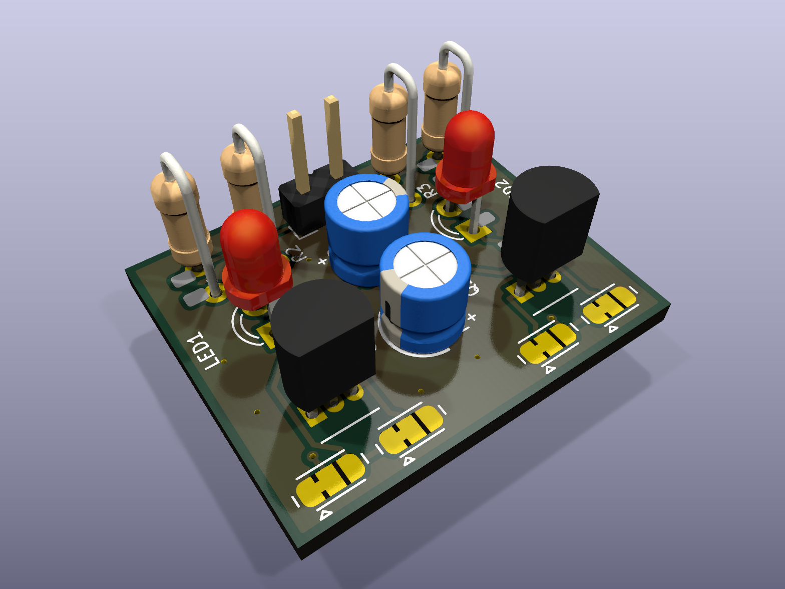
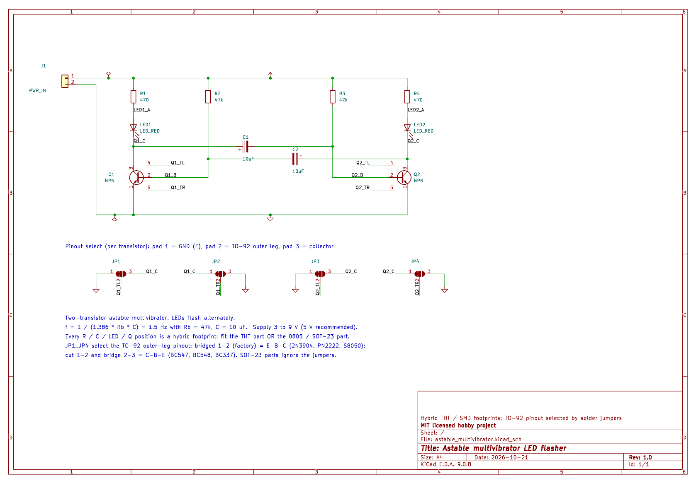
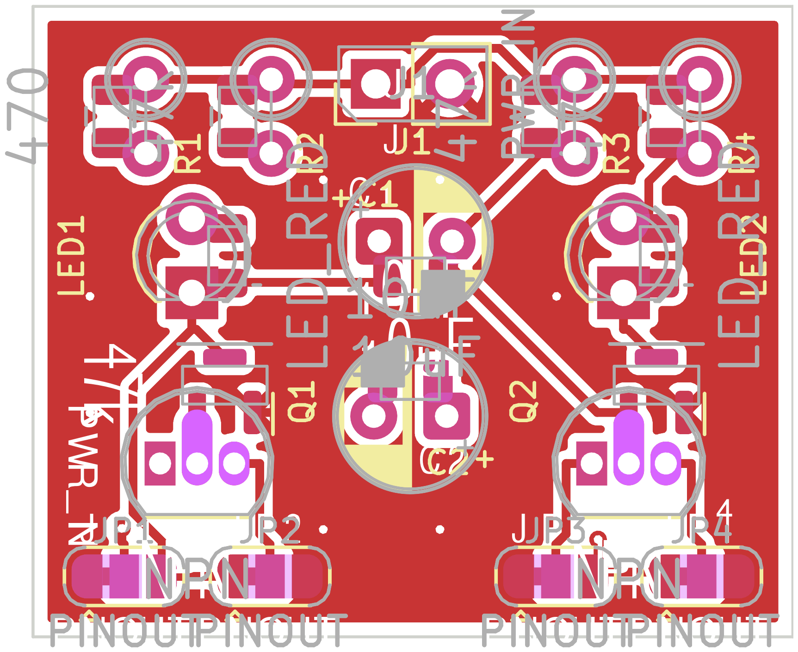
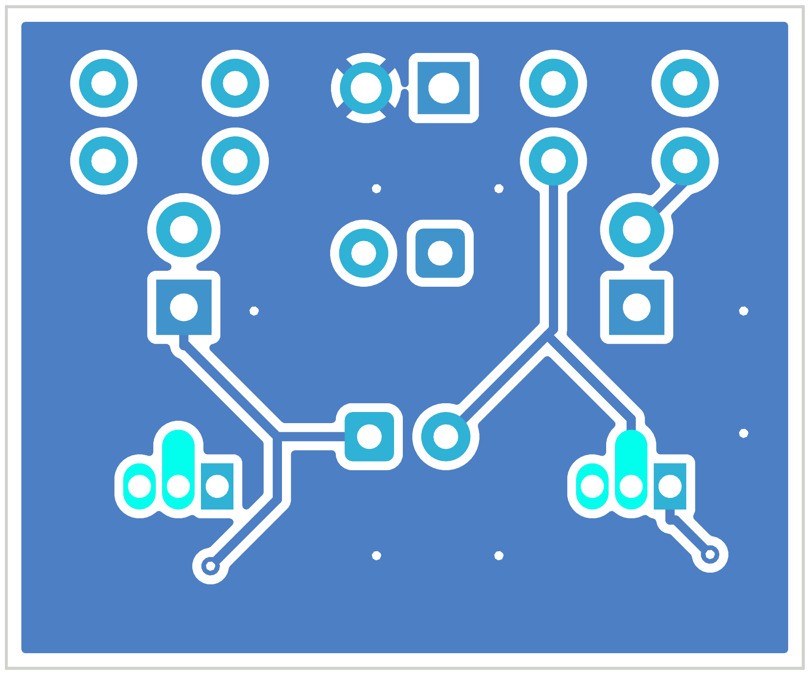
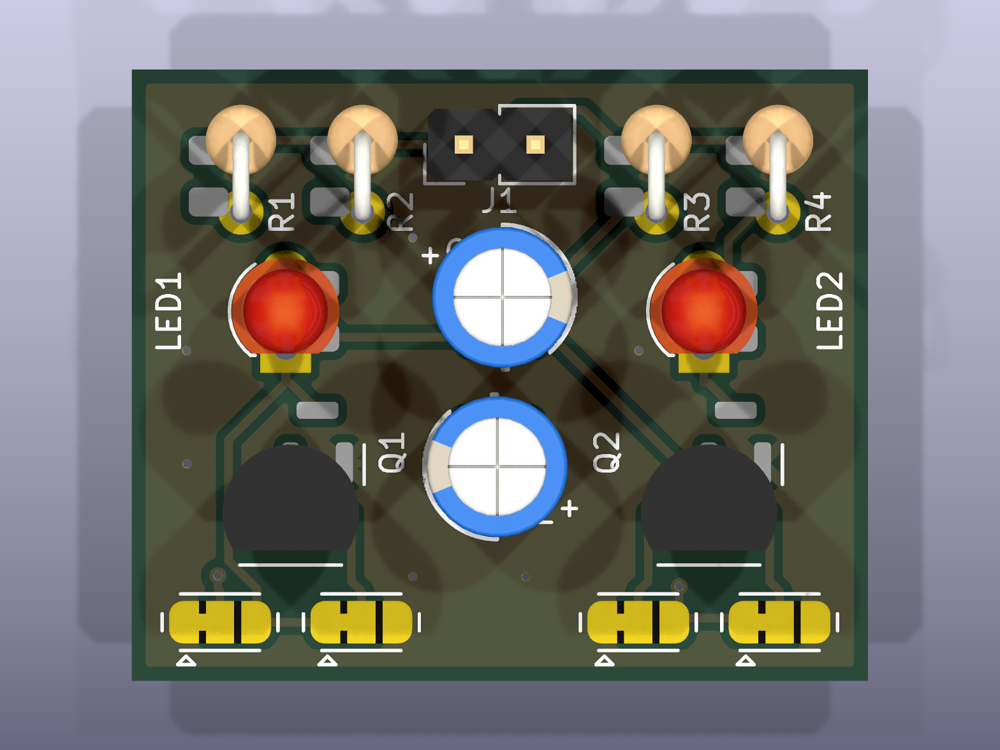
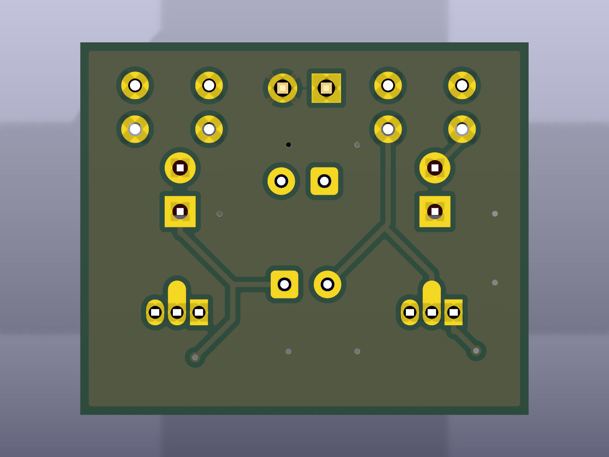
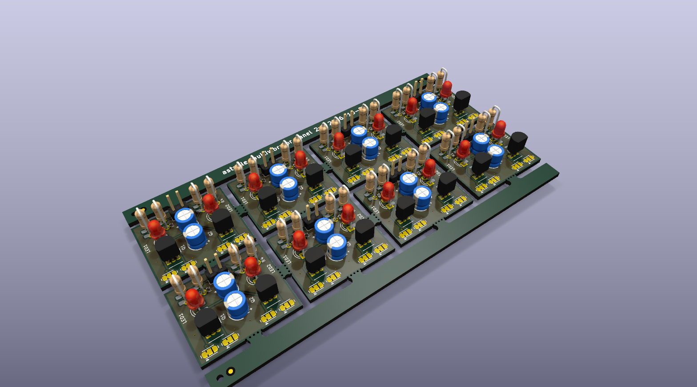
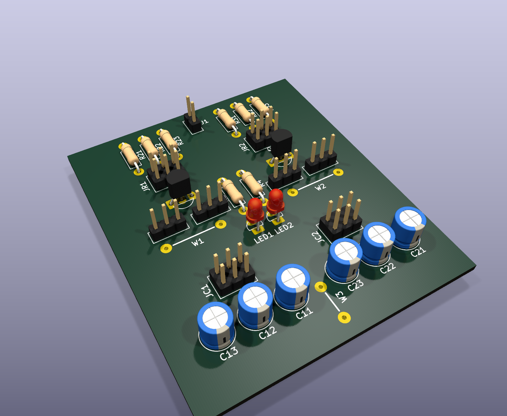

# Astable Multivibrator LED Flasher

A tiny two-transistor LED flasher on a 26 x 22 mm board, built so you can
populate it from whatever parts are in your drawer. Every resistor, capacitor,
LED and transistor position accepts EITHER a through-hole part OR an SMD part,
and the transistor footprint takes a TO-92 in either common pinout (E-B-C or
C-B-E) or a SOT-23, selected with copper-only solder jumpers.



Designed in KiCad 9, DRC and ERC clean, panelized 2 x 4 with mouse bites, and
released under the MIT license. Gerbers are ready to upload.

## Features

- Classic textbook astable multivibrator: 2 transistors, 4 resistors, 2 caps, 2 LEDs
- About 1.5 Hz alternating flash with 47k / 10 uF (easy to change)
- 3 V to 9 V DC supply (5 V recommended)
- Hybrid footprints: axial 0207 or 0805 resistors, 5 mm radial or 0805 caps,
  3 mm or 0805 LEDs, TO-92 or SOT-23 transistors, all on the same pads
- Pinout-select solder jumpers: 2N3904 / PN2222 / S8050 (E-B-C) or
  BC547 / BC548 / BC337 (C-B-E) both fit the same TO-92 holes
- Minimum board area, 2 layers, GND pour both sides, copper kept 0.5 mm from
  the edge so the 2 x 4 panel can be mouse-bitten or V-cut

## Gallery

| Schematic | PCB top | PCB bottom |
|---|---|---|
|  |  |  |

| 3D top | 3D bottom | 2 x 4 panel |
|---|---|---|
|  |  |  |

Full-size schematic: [images/schematic.svg](images/schematic.svg) or
[docs/astable_multivibrator_schematic.pdf](docs/astable_multivibrator_schematic.pdf).

## Specifications

| Item | Value |
|---|---|
| Board | 26.15 x 21.73 mm, 2 layer, 1.6 mm FR4, 1 oz copper |
| Supply | 3 to 9 V DC on J1 (square pad = VCC); 5 V recommended |
| Flash rate | about 1.5 Hz (simulated 1.8 Hz at 5 V with LED drop included) |
| LED current | about 7 mA at 5 V, 15 mA at 9 V with 470 R |
| Min track / clearance | 0.3 mm tracks, 0.2 mm clearance, 0.3 mm vias |
| Fab | any standard 2-layer service (JLCPCB, PCBWay, OSH Park and friends) |
| Panel | 2 x 4 grid, 110.3 x 59.4 mm, mouse bites, 5 mm rails with tooling holes and fiducials |

## How it works

Q1 and Q2 are cross-coupled through C1 and C2. When Q1 turns on, its collector
pulls the far side of C1 low, which drives Q2's base negative and holds Q2 off.
R3 then charges C1 until Q2's base reaches 0.7 V, Q2 turns on, and the same
thing happens in mirror. Each LED sits in series with a collector resistor, so
LED1 lights while Q1 conducts and LED2 lights while Q2 conducts.

```
half period  T = 0.693 * Rb * C = 0.693 * 47k * 10u = 0.33 s   (f = 1 / 2T = 1.5 Hz)
LED current  I = (Vcc - Vf_LED - Vce_sat) / Rc = (5 - 2.0 - 0.2) / 470 = 6 mA
```

Change the speed with the timing caps: 22 uF gives about 0.7 Hz, 4.7 uF about
3.5 Hz. Above roughly 6 V the OFF transistor's base-emitter junction is briefly
driven past its reverse rating each half cycle. This is classic-kit behaviour,
harmless at these currents, but the timing drifts a little.

## Bill of materials

No part numbers on purpose. Use what you have.

| Ref | Value | Through-hole option | SMD option | Notes |
|---|---|---|---|---|
| R1, R4 | 470 R | axial 0207 (1/4 W) stood vertical | 0805 | LED series resistors |
| R2, R3 | 47k | axial 0207 stood vertical | 0805 | base bias, sets the speed |
| C1, C2 | 10 uF, 16 V or more | 5 mm radial electrolytic, 2.5 mm pitch | 0805 X5R / X7R | square pad = + |
| LED1, LED2 | red or green, 3 mm | 3 mm LED | 0805 LED | square pad = cathode (K) |
| Q1, Q2 | any general-purpose NPN | TO-92: 2N3904, 2N4401, PN2222, S8050, BC547, BC548, BC337 | SOT-23: MMBT3904, BC847, MMBT2222 | hFE 70 or more |
| J1 | 1x2 pin header 2.54 mm | pin header or just wires | - | square pad = VCC |
| JP1 to JP4 | solder jumpers | copper only, nothing to buy | | factory bridged 1-2 |

## Transistor pinout jumpers

The TO-92 centre hole is always the base. The two outer holes each pass through
a 3-pad solder jumper, so the outer legs can be swapped between emitter and
collector without a different footprint.

| Your TO-92 pinout (flat face toward you, legs down) | Example parts | What to do |
|---|---|---|
| E-B-C | 2N3904, 2N4401, PN2222, S8050 | nothing, jumpers come bridged 1-2 |
| C-B-E | BC547, BC548, BC549, BC337 | on BOTH jumpers of that transistor: cut the 1-2 trace, bridge 2-3 with solder |
| SOT-23 (any) | MMBT3904, BC847, MMBT2222 | jumpers do not matter |

JP1 and JP2 belong to Q1, JP3 and JP4 to Q2. Pad 1 = GND (emitter), pad 2 =
centre = the TO-92 outer leg, pad 3 = collector.

## Ordering boards

Upload one of these zips to your fab as a 2-layer, 1.6 mm, 1 oz board:

| What | File |
|---|---|
| Single board | [release/astable_multivibrator_gerbers_board.zip](release/astable_multivibrator_gerbers_board.zip) |
| 2 x 4 panel (8 boards per piece) | [release/astable_multivibrator_gerbers_panel_2x4.zip](release/astable_multivibrator_gerbers_panel_2x4.zip) |
| STEP model | [release/astable_multivibrator.step](release/astable_multivibrator.step) |

A filled-in PCBWay order form is in [release/PCBWAY_ORDER.md](release/PCBWAY_ORDER.md);
JLCPCB defaults work as well. For the panel choose "panel by customer" and
tell the fab the panel already contains mouse bites and rails. Any mask colour,
any finish; HASL is fine for hand soldering.

## Building it

Follow [docs/assembly.md](docs/assembly.md). Short version:

1. Decide THT or SMD per position (never both in one position).
2. Set the pinout jumpers for your TO-92 transistors (see above).
3. Solder SMD parts first, then the low parts, then the tall ones.
4. Check polarity: LED cathode and capacitor + on the square pads, TO-92 flat
   face toward the jumpers.
5. Apply 5 V to J1 (square pad = +). Both LEDs should flash alternately.

## Versions

| | v1 (this page) | v2 |
|---|---|---|
| Board | 26 x 22 mm, 2 layers, fab-made | 62 x 72 mm, 1 layer, make it at home |
| Parts | THT or SMD per position | THT only |
| Timing | fixed 47k / 10 uF | 3 x 3 selectable with header shunts |
| Pinout select | solder jumpers | pin headers with shunts |
| Files | `kicad/astable_multivibrator/`, `release/` | `kicad/astable_v2_single_layer/`, `release/v2/` |

v2 details, etching and build guide: [docs/v2_home_etching.md](docs/v2_home_etching.md).



## Simulate it in your browser

CircuitJS (falstad.com) version of the circuit, 47k / 10 uF:
[open the simulation](https://www.falstad.com/circuit/circuitjs.html?ctz=CQAgjCAMB0lwrOGAmOyDs6DMkAcyA2ATiPRHknPMgCgA3EIgkLVR5ggFih88sUqDo8GgHN2LNkxbxkUGgHcJXcAUoraSsGpArUuXd00h9hkH3VHF5uGc6cDG69NaVkfSYOvvKrlgQM-WgAnVUswiMpOdFptOW1KBIjkdxMQABMAUwAzAEMAVwAbABcAWkLM9PAeIUhkaySU7jAiOSb5LVaTVJ9uq2KTPBMPXt7EmsHjUfhmXqCaUNM9IbHzGLgF8wc7baSomJo4rYMk+wN2uSy8orKKqohBKFh6pTO+8213405P9qwAr40AYWYa+AGrB48VDGf7nGb+QJsEI2cIg1bROC0ADG4C67Ra8XQzESmVKkAEHVxhOYWFwzSJlNp9JpdNBjNZvTRHmxH1mqR+s1wBhJZIp31+QveyElUx6kou3O8PRGK0VAA8JCDpCDmtwAIIAZ2KuQARhUQABbG4ASzo1pNwVyxQA9qEADIAUQAIiBsoVcgaABaZYIAGjWAGsQAB6JAgfIAMXDpud+QGYGEIAAEgAvaAgADCgdyADtRJkQAAlZDhytYcMFsANuQuy1OrGBkDFYMgABSlZjfYLIGDuSywQNIGdJa7PbochNztywXS0BoQA).
The text dump is in [docs/circuitjs/](docs/circuitjs/) if the link ever breaks
(File > Import From Text).

## Repository layout

```
kicad/astable_multivibrator/   v1 KiCad 9 project: schematic, board, lib tables
kicad/astable_v2_single_layer/ v2 KiCad 9 project (single sided, selectable RC)
kicad/lib/Hybrid.*             v1 hybrid THT + SMD footprints and 5-pin NPN symbol
kicad/lib/HomeEtch.pretty      v2 home-etch footprints; AstableV2.kicad_sym = TO-92 socket symbol
kicad/panel/                   v1 KiKit preset, panelize.sh, panel board
kicad/tools/                   generators: footprints, 3D models, schematics, boards, routing, netlist check
images/, images/v2/            schematic, layer plots and 3D renders
docs/                          assembly guides, schematic PDFs, design check reports, spice sweep, CircuitJS
release/, release/v2/          gerber zips, STEP, print PDFs, order notes
datasheets/                    generic BOM CSV
analysis/                      analyzer outputs from the design checks
CLAUDE.md, STATUS.md           design brief and phase log of the agent workflow that produced the board
```

## Regenerating

Everything was made with KiCad 9.0.8 and scripts in `kicad/tools/`:

```
/usr/bin/python3 kicad/tools/build_hybrid_footprints.py   # hybrid footprints (pcbnew API)
/usr/bin/python3 kicad/tools/add_3d_models.py             # attach KiCad 3D models to them
python3 kicad/tools/layout_schematic.py                   # re-lay the schematic sheet
/usr/bin/python3 kicad/tools/compare_netlist.py <net> <pcb>   # schematic vs board connectivity
kicad/panel/panelize.sh                                   # KiKit 2 x 4 panel + DRC
```

v2 has its own chain (footprints, schematic, board, single-layer routing, GND pour),
listed at the end of [docs/v2_home_etching.md](docs/v2_home_etching.md).

Routing was done with Freerouting via `kicad/tools/route_freerouting.py`.

## Verification status

- ERC: 0 errors, 0 warnings.
- DRC: 0 errors, 0 unconnected. 10 warnings of type lib_footprint_mismatch
  are intentional: silk outlines that crossed SMD lands were moved to the Fab
  layer on the board only.
- Schematic vs board: all 40 pins on 12 nets match (compare_netlist.py).
- Full-circuit ngspice transient: 1.83 Hz / 7 mA at 5 V, 1.70 Hz / 15 mA at 9 V
  (see docs/check_schematic_report.md). Generic transistor and LED models.
- Independent gerber review: docs/release_review.md.

Not yet verified on a physical board. If you build one, open an issue with a
photo and the measured flash rate.

## License

MIT, see [LICENSE](LICENSE). This covers the schematic, board, footprints,
scripts and documentation in this repository.

The footprints in `kicad/lib/` are derived from the KiCad
footprint library and the 3D renders use the KiCad 3D model library. Those
libraries are licensed CC-BY-SA 4.0 with the KiCad library exception, which
allows their use in designs under any license.
