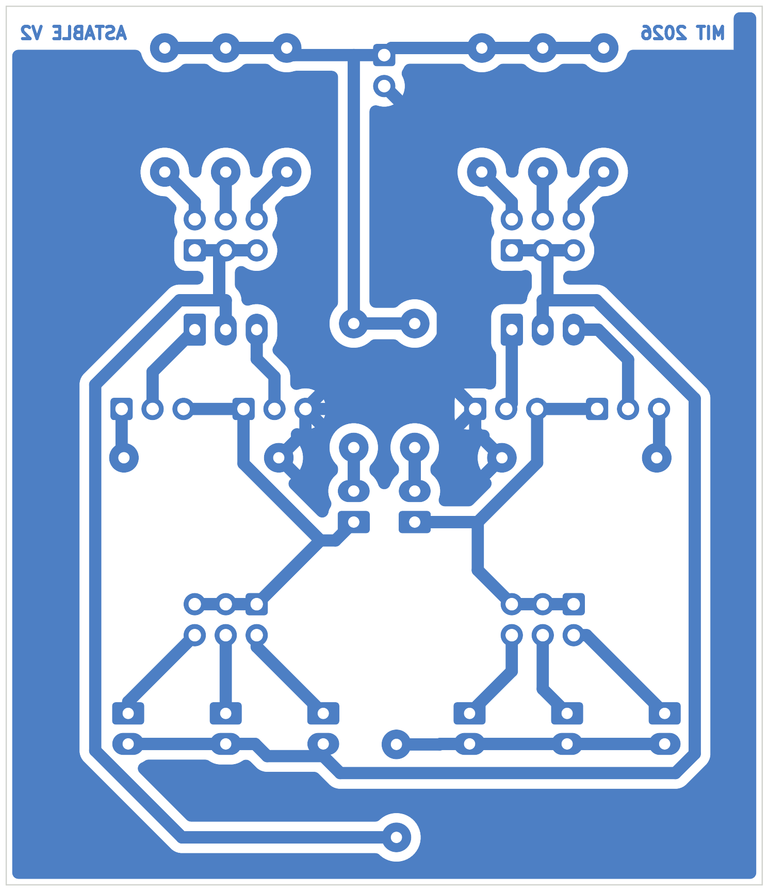

# v2: single-sided, home-etchable board with selectable timing

v2 is the same two-transistor flasher laid out for making at home: one copper layer
(bottom), 1.0 mm tracks, 0.6 mm gaps, 1.8 to 2.4 mm pads with 0.9 to 1.0 mm drills,
through-hole parts only, and three bare wire links on the component side. Three base
resistors and three timing capacitors per side sit on 2x3 pin headers so you pick the
flash rate with a shunt instead of soldering.

Board 62 x 72 mm. KiCad 9 project in `kicad/astable_v2_single_layer/`.

| | |
|---|---|
|  |  |

Schematic: [images/v2/schematic.png](../images/v2/schematic.png),
PDF: [astable_v2_schematic.pdf](astable_v2_schematic.pdf).
Try the circuit in the browser (CircuitJS): [open simulation](https://www.falstad.com/circuit/circuitjs.html?ctz=CQAgjCAMB0lwrOGAmOyDs6DMkAcyA2ATiPRHknPMgCgA3EIgkLVR5ggFih88sUqDo8GgHN2LNkxbxkUGgHcJXcAUoraSsGpArUuXd00h9hkH3VHF5uGc6cDG69NaVkfSYOvvKrlgQM-WgAnVUswiMpOdFptOW1KBIjkdxMQABMAUwAzAEMAVwAbABcAWkLM9PAeIUhkaySU7jAiOSb5LVaTVJ9uq2KTPBMPXt7EmsHjUfhmXqCaUNM9IbHzGLgF8wc7baSomJo4rYMk+wN2uSy8orKKqohBKFh6pTO+8213405P9qwAr40AYWYa+AGrB48VDGf7nGb+QJsEI2cIg1bROC0ADG4C67Ra8XQzESmVKkAEHVxhOYWFwzSJlNp9JpdNBjNZvTRHmxH1mqR+s1wBhJZIp31+QveyElUx6kou3O8PRGK0VAA8JCDpCDmtwAIIAZ2KuQARhUQABbG4ASzo1pNwVyxQA9qEADIAUQAIiBsoVcgaABaZYIAGjWAGsQAB6JAgfIAMXDpud+QGYGEIAAEgAvaAgADCgdyADtRJkQAAlZDhytYcMFsANuQuy1OrGBkDFYMgABSlZjfYLIGDuSywQNIGdJa7PbochNztywXS0BoQA)
(text dump for File > Import From Text: [docs/circuitjs/astable_multivibrator.txt](circuitjs/astable_multivibrator.txt)).

## Files for making the board

| File | What it is |
|---|---|
| `release/v2/astable_v2_copper_toner_transfer_print_as_is.pdf` | bottom copper at 1:1, as KiCad shows it (seen from the top). Print this for toner transfer or for a film you lay toner side down on the copper. |
| `release/v2/astable_v2_copper_mirrored_for_photoresist.pdf` | the same pattern mirrored, for a transparency laid emulsion up |
| `release/v2/astable_v2_assembly_top.pdf` | component side drawing: outlines, designators, polarity marks |
| `release/v2/astable_v2_gerbers_single_sided.zip` | B.Cu, B.Mask, F.Silk, Edge.Cuts and drill if you would rather order it (1 layer, 1.6 mm) |
| `release/v2/astable_v2.step` | 3D model |

Orientation check: the copper carries the text ASTABLE V2 and MIT 2026. When you look at
the etched copper side, both must read correctly. If they read mirrored, you printed the
wrong file or ironed the wrong face.

Print at 100 % scale (no "fit to page"). The board outline is 62 x 72 mm; measure it on
the print before transferring.

## Etching notes

1. Clean the copper with fine abrasive and alcohol. Transfer or expose, then etch
   (ferric chloride or HCl plus peroxide, warm, agitated). The GND pour leaves little
   copper to remove, so the etch is quick; check for bridges between the 0.6 mm gaps
   around the headers.
2. Drill 0.9 mm for resistors, caps, LEDs and TO-92, 1.0 mm for the pin headers and
   wire links. Every pad has a 0.4 mm or wider annular ring, so a slightly wandering
   drill still leaves copper.
3. Remove the toner or resist, tin the copper if you can (makes soldering easier), or
   just flux it well.

## Component side assembly

Fit in this order: the three wire links W1, W2, W3 (bare tinned wire, component side,
between the marked holes), resistors, LEDs, transistors, pin headers, capacitors.

| Ref | Part | Note |
|---|---|---|
| R1, R4 | 470 R axial | LED series |
| R21, R22, R23 / R31, R32, R33 | 22k, 47k, 100k axial | base resistor options, left to right |
| C11, C12, C13 / C21, C22, C23 | 4.7 uF, 10 uF, 47 uF radial, 16 V or more | up to 6.3 mm diameter, 2.5 mm pitch, + at the square pad (top) |
| LED1, LED2 | 3 mm LED | cathode (flat side) at the square pad |
| Q1, Q2 | any TO-92 NPN | flat face toward the JP headers (silk line) |
| JR1, JR2, JC1, JC2 | 2x3 pin header plus one shunt each | selection |
| JP1 to JP4 | 1x3 pin header plus one shunt each | TO-92 pinout |
| J1 | 1x2 pin header | square pad = VCC, 3 to 9 V |
| W1, W2, W3 | wire links | GND x2, Q1 base |

## Choosing the flash rate

JR1 and JR2 select the base resistor for each stage, JC1 and JC2 the timing capacitor.
Each 2x3 header takes ONE shunt, placed across one pin pair. The pairs line up with the
parts they select: the JR pairs sit directly below R21 / R22 / R23 (R31 / R32 / R33), the
JC pairs directly above C11 / C12 / C13 (C21 / C22 / C23). Put the shunt in line with the
part you want. The square pad marks pin 1 of every header. Both stages normally get the
same setting; different settings give an asymmetric flash (one LED on longer than the
other).

| Shunt on the pair in line with | Value | Header pins |
|---|---|---|
| R21 / R31 | 22k | 1-2 |
| R22 / R32 | 47k | 3-4 |
| R23 / R33 | 100k | 5-6 |
| C11 / C21 | 4.7 uF | 1-2 |
| C12 / C22 | 10 uF | 3-4 |
| C13 / C23 | 47 uF | 5-6 |

Measured in ngspice (generic 2N3904-class model, red LED), both stages set the same:

| Vcc | Rb | C | f textbook (Hz) | f ngspice (Hz) | period (s) | LED peak (mA) | cycles measured |
|---|---|---|---|---|---|---|---|
| 5 V | 22k | 4.7uF | 6.98 | 8.27 | 0.121 | 7.0 | 9 |
| 5 V | 22k | 10uF | 3.28 | 3.89 | 0.257 | 7.0 | 8 |
| 5 V | 22k | 47uF | 0.70 | 0.83 | 1.209 | 7.0 | 9 |
| 5 V | 47k | 4.7uF | 3.27 | 3.90 | 0.256 | 7.0 | 8 |
| 5 V | 47k | 10uF | 1.54 | 1.83 | 0.546 | 7.0 | 8 |
| 5 V | 47k | 47uF | 0.33 | 0.39 | 2.564 | 7.0 | 8 |
| 5 V | 100k | 4.7uF | 1.54 | 2.11 | 0.473 | 7.0 | 10 |
| 5 V | 100k | 10uF | 0.72 | 0.99 | 1.007 | 7.0 | 10 |
| 5 V | 100k | 47uF | 0.15 | 0.21 | 4.736 | 7.0 | 10 |
| 9 V | 22k | 4.7uF | 6.98 | 7.52 | 0.133 | 15.3 | 7 |
| 9 V | 22k | 10uF | 3.28 | 3.52 | 0.284 | 15.3 | 7 |
| 9 V | 22k | 47uF | 0.70 | 0.75 | 1.333 | 15.3 | 8 |
| 9 V | 47k | 4.7uF | 3.27 | 3.77 | 0.265 | 15.3 | 8 |
| 9 V | 47k | 10uF | 1.54 | 1.66 | 0.603 | 15.3 | 8 |
| 9 V | 47k | 47uF | 0.33 | 0.35 | 2.836 | 15.3 | 8 |
| 9 V | 100k | 4.7uF | 1.54 | unstable (does not saturate) | - | 15.3 | - |
| 9 V | 100k | 10uF | 0.72 | unstable (does not saturate) | - | 15.3 | - |
| 9 V | 100k | 47uF | 0.15 | unstable (does not saturate) | - | 15.3 | - |

The textbook formula f = 1 / (1.386 Rb C) ignores the LED drop, so the real rate is
10 to 30 % higher at 5 V. The three 9 V / 100k rows are not a flasher any more: with
83 uA of base current the transistors cannot saturate 15 mA, the model runs into its
gain roll-off and the output degenerates into fast ringing. Use 22k or 47k at 9 V, or
100k only up to about 6 V, or a high-gain transistor (BC547C, 2N4401).

Unselected capacitors stay tied to the base on their minus side with the plus side
floating; unselected resistors float at the base end. Neither affects the circuit.

## Transistor pinout headers

Same scheme as v1, now with shunts instead of solder blobs. JP1 and JP2 belong to Q1,
JP3 and JP4 to Q2. Pin 1 = GND, pin 2 = the TO-92 outer leg, pin 3 = collector.

| TO-92 pinout (flat face toward you, legs down) | Parts | Shunts |
|---|---|---|
| E-B-C | 2N3904, 2N4401, PN2222, S8050 | both headers pins 1-2 |
| C-B-E | BC547, BC548, BC549, BC337 | both headers pins 2-3 |

Pin 1 is the square pad, at the left end of each JP header when J1 is at the top. So
E-B-C parts get both shunts on the left pair, C-B-E parts both shunts on the right pair.

## Why three wire links

With GND, the collector and both outer transistor legs all needing to reach both pinout
headers, the pinout block is not planar on one copper layer (it contains a K3,3). W1 and
W2 each carry GND across the collector trace of their stage. W3 carries the Q1 base net
from the JC2 capacitor block to the left edge, over the C1x minus bus. All three are
plain tinned wire.

## Verification

- ERC 0 errors, 0 warnings. DRC clean (0 errors, 0 warnings, 0 unconnected) against the
  home-etch rules in the project file: 0.8 mm minimum track, 0.6 mm clearance, 1.0 mm
  copper to edge. Silkscreen checks are switched off (nothing is silkscreened on an
  etched board).
- Schematic vs board: 82 of 82 pins match (`kicad/tools/compare_netlist.py`).
- No copper on F.Cu, no vias (rule area on the top layer, checked by the router wrapper).
- CircuitJS drawing checked with the circuit-sim connectivity audit against the net
  list; the link itself has not been opened in a browser from here.
- Not yet etched or built. Report back if you make one.

## Regenerating

```
/usr/bin/python3 kicad/tools/build_homeetch_footprints.py   # kicad/lib/HomeEtch.pretty
python3 kicad/tools/gen_v2_schematic.py                     # schematic (fixed UUIDs)
kicad-cli sch export netlist -o kicad/astable_v2_single_layer/astable_v2.net kicad/astable_v2_single_layer/astable_v2.kicad_sch
/usr/bin/python3 kicad/tools/gen_v2_board.py                # placement from the PLACEMENT table
/usr/bin/python3 kicad/tools/route_v2.py kicad/astable_v2_single_layer/astable_v2.kicad_pcb   # Freerouting, bottom only
/usr/bin/python3 kicad/tools/finalize_v2.py                 # adopt route, GND pour, designators
python3 kicad/tools/v2_project_rules.py                     # home-etch DRC rules into the .kicad_pro (also run by the two scripts above)
python3 docs/spice/v2_timing_sweep.py                       # the table above
python3 docs/circuitjs/build_circuitjs.py                   # CircuitJS link
```
